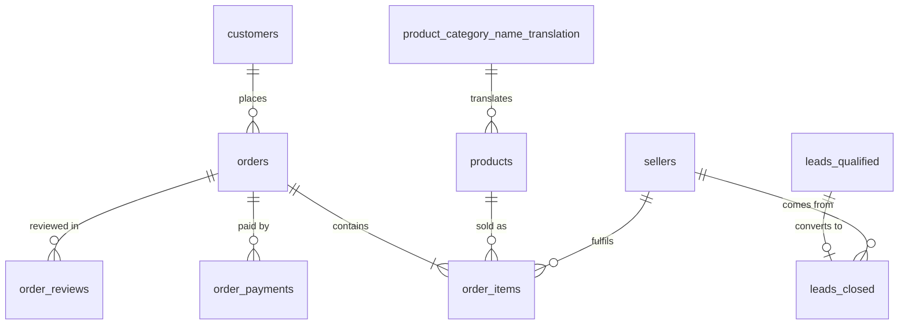
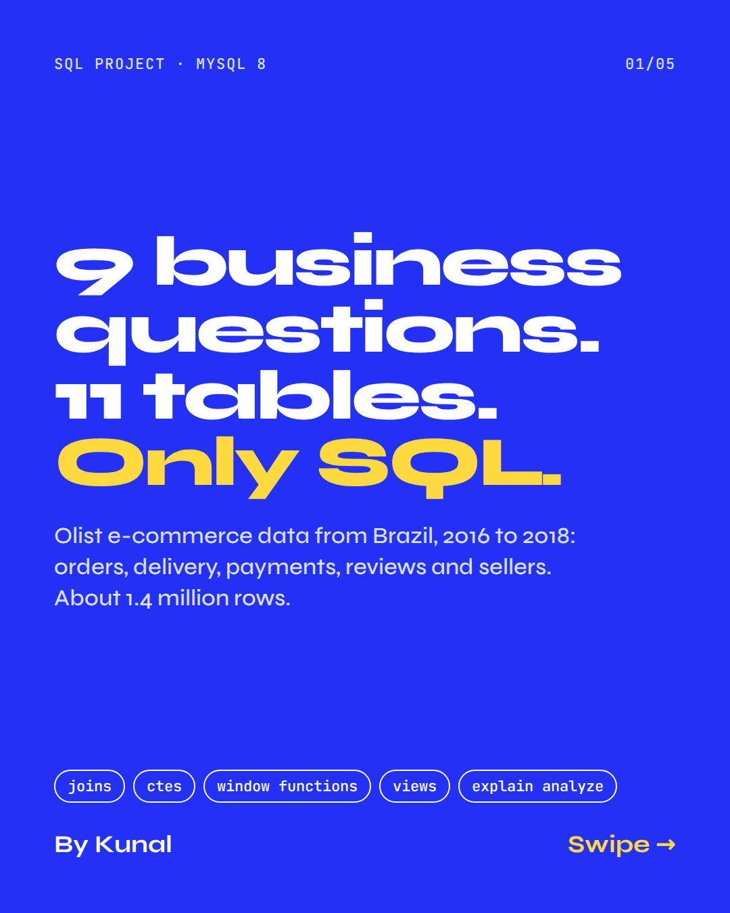
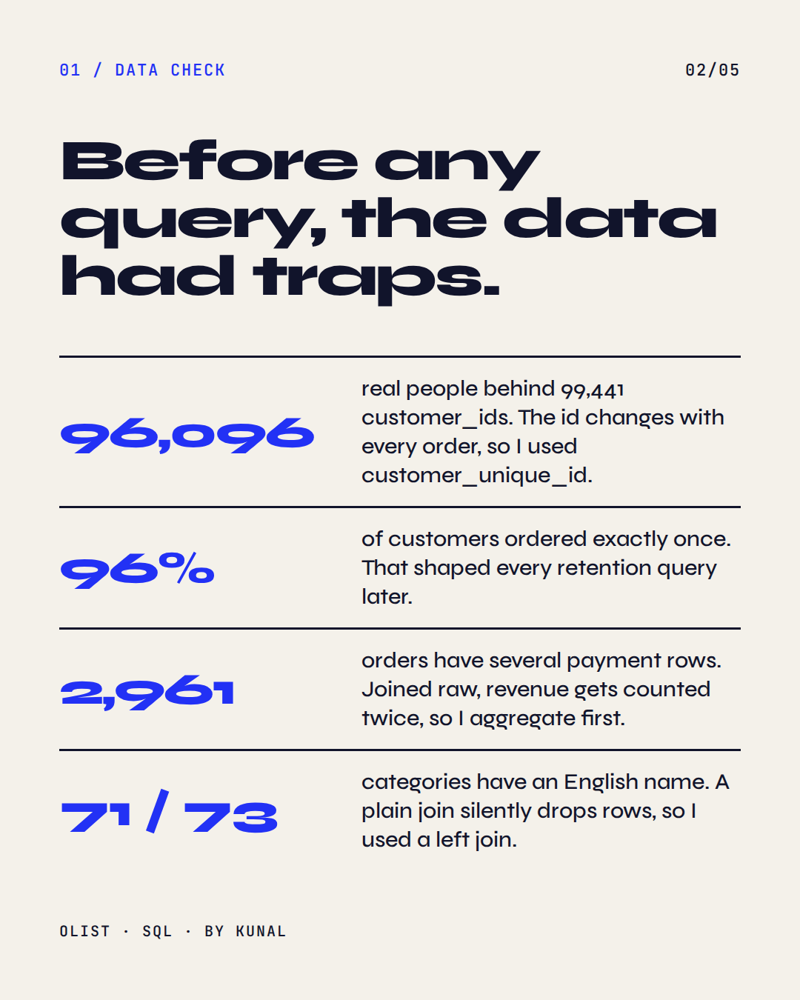
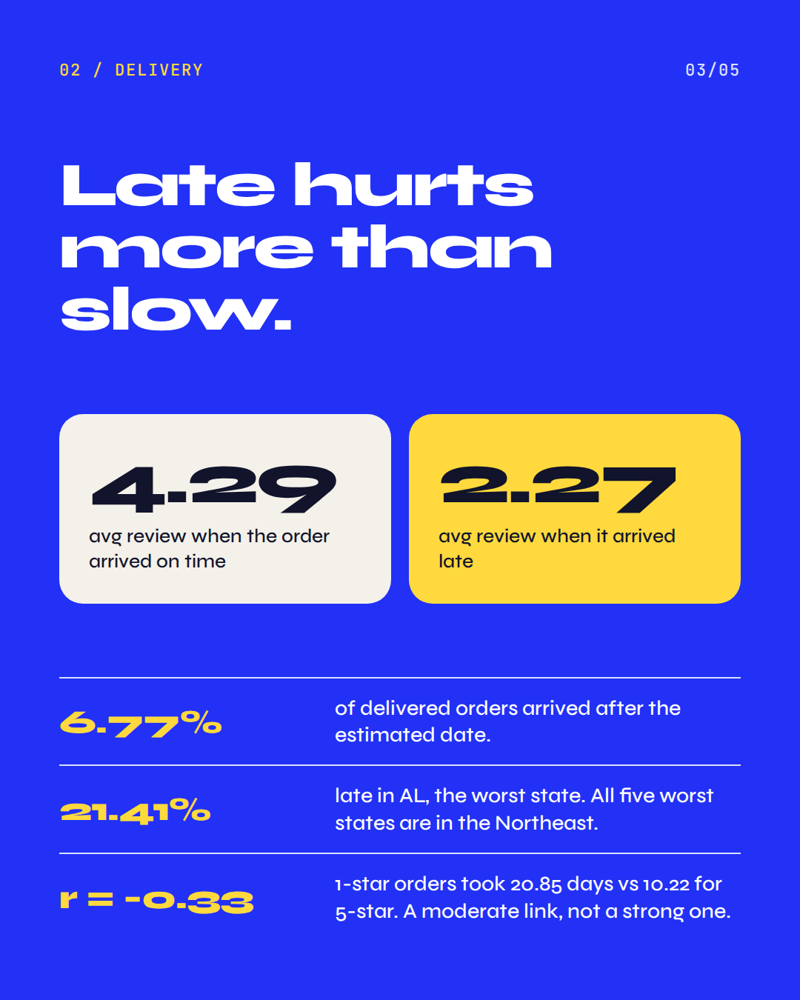
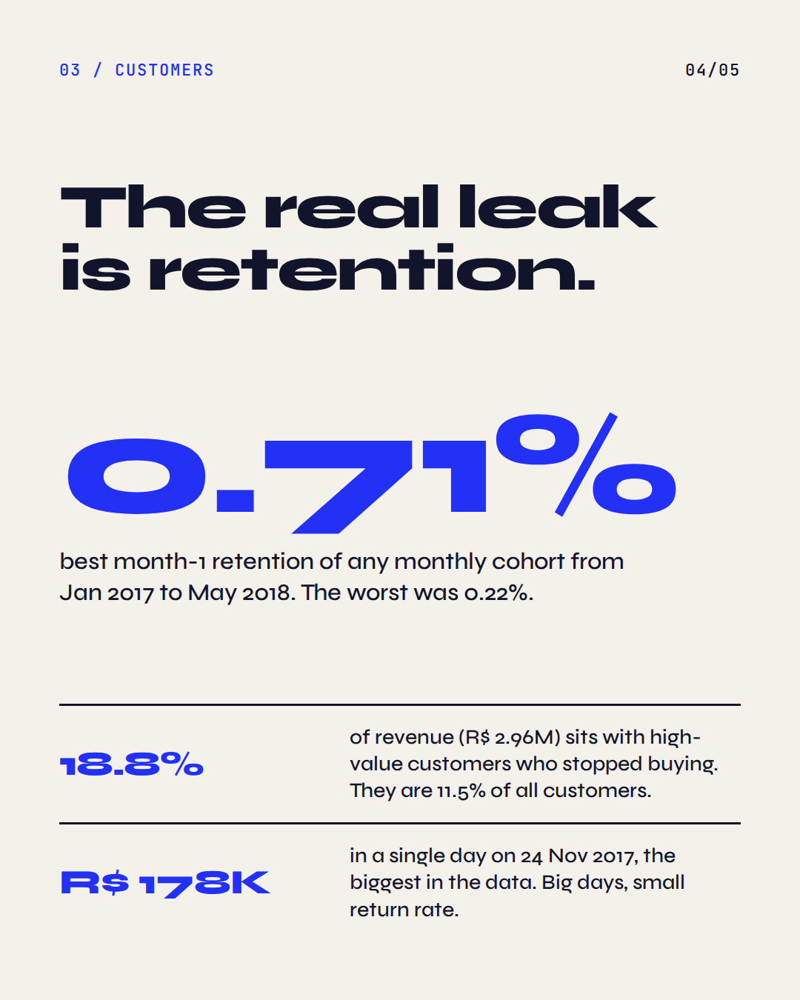
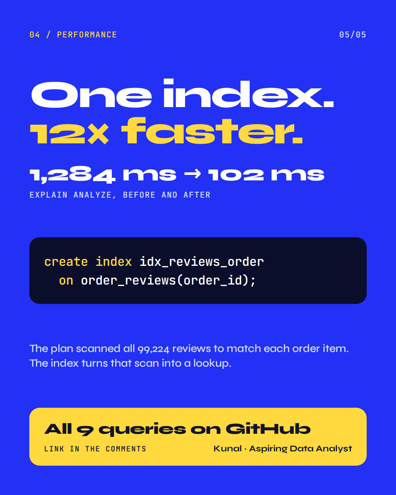

# Olist E-commerce: 9 Business Questions in SQL

I took the Olist Brazilian e-commerce dataset (11 tables, about 1.4 million rows) and answered 9 business questions about delivery, payments, reviews, customers and sellers, using only SQL in MySQL 8. For one query I also measured the run time before and after adding an index.

| | |
|---|---|
| **Database** | MySQL 8 |
| **Data** | Olist orders, 2016 to 2018 (amounts in Brazilian reais, R$) |
| **Tools** | MySQL, Python (SQLAlchemy, jupysql), Jupyter |
| **Notebook** | [`notebooks/olist_sql_analysis.ipynb`](notebooks/olist_sql_analysis.ipynb) |
| **Plain SQL** | [`sql/`](sql/), one file per question |

## What I found

- **Late deliveries hurt reviews.** 6.77% of delivered orders arrived after the estimated date. Late orders average 2.27 stars against 4.29 for on-time ones. The worst state is AL at 21.41%, and all five worst states are in the Northeast.
- **Retention is the weak spot.** 96% of customers ordered once. Month-1 retention across monthly cohorts ranged from only 0.22% to 0.71%.
- **High-value customers are slipping away.** 11.5% of customers are high-value churn risks, and they hold 18.8% of revenue (R$ 2.96M).
- **One index made a big difference.** Indexing `order_reviews(order_id)` took a join-heavy query from about 1,284 ms to 102 ms in `explain analyze` (about 12.6x).

## The 9 questions

| # | Question | SQL used | Result |
|---|---|---|---|
| 1 | How often do orders arrive late, and where? | conditional aggregation, date logic | 6.77% late overall, AL worst at 21.41% |
| 2 | Which payment method and installment plan give the biggest orders? | per-order CTE, buckets | credit card has the highest average order (R$ 166.47); 7+ installments is about 3.5x a lump sum |
| 3 | Do slow deliveries get worse reviews? | `timestampdiff`, Pearson r written by hand | r = -0.33; 1-star orders took 20.85 days vs 10.22 for 5-star |
| 4 | Which customer segments matter most? | `ntile(4)`, RFM scoring, `case` | high-value churn risks hold 18.8% of revenue |
| 5 | How does revenue trend day to day? | recursive CTE calendar, rolling window frames | biggest day 24 Nov 2017 (R$ 178K); 30-day average peaked around 15 Dec 2017 (R$ 44K) |
| 6 | Who are the top sellers in each category? | `dense_rank()` over a partition | one seller can dominate a category; sellers under 4.0 stars are filtered out |
| 7 | Can dashboards get one clean table? | `create view`, `left join`, `coalesce` | `vw_executive_dashboard` |
| 8 | Do customers come back after their first order? | cohort analysis, `timestampdiff` | month-1 retention 0.22% to 0.71% |
| 9 | Can a slow query be made faster? | `explain analyze`, `create index` | 1,284 ms to 102 ms |

## Query optimization (Q9)

`explain analyze` showed a full scan of all 99,224 rows in `order_reviews` driving a nested loop. Indexing the join key fixed that:

```sql
create index idx_reviews_order
  on order_reviews(order_id);
```

The plan still scans `order_items` to filter by seller, so `order_items(seller_id)` is the next index to try. Indexes also slow down writes, so I would only add them on join keys that are used often.

## Data model



`geolocation` links to customers and sellers through the zip code prefix.

Two things I had to handle in the data:
- `customer_id` changes with every order, so customers are counted by `customer_unique_id` (99,441 customer ids belong to 96,096 real people).
- One order can have several payment rows, so payments are summed per order before joining, otherwise revenue is double counted.

## Repo structure

```
olist-ecommerce-sql-analysis/
├── README.md
├── LICENSE
├── requirements.txt
├── .gitignore
├── notebooks/
│   └── olist_sql_analysis.ipynb
├── sql/
│   ├── 00_row_counts.sql
│   ├── 01_delivery_sla.sql
│   ├── 02_payment_behaviour.sql
│   ├── 03_reviews_vs_delivery.sql
│   ├── 04_rfm_segmentation.sql
│   ├── 05_rolling_revenue.sql
│   ├── 06_top_sellers_by_category.sql
│   ├── 07_executive_view.sql
│   ├── 08_cohort_retention.sql
│   └── 09_index_optimization.sql
├── data/
│   └── README.md
└── images/
    └── carousel/
```

## How to run

1. Download the two Kaggle datasets and import the 11 CSVs into a MySQL 8 database called `olist` (see [`data/README.md`](data/README.md)).
2. Install the Python packages:
   ```bash
   pip install -r requirements.txt
   ```
3. Open the notebook:
   ```bash
   jupyter lab notebooks/olist_sql_analysis.ipynb
   ```
   The setup cell connects as `root@localhost` to the `olist` database. Change `DB_USER`, `DB_HOST` and `DB_NAME` there if yours differ. The password is read from the `MYSQL_PWD` environment variable or asked for in a hidden prompt, so it is never saved in the notebook.
4. Run the notebook top to bottom. In Q9, run the reset cell (9-0) first, so the "before" timing is measured without the index.

Prefer plain SQL? Run the files in `sql/` in MySQL Workbench. Window functions, CTEs and `explain analyze` need MySQL 8.0.18 or newer.

## Limitations

- The Q4 segment rules are my own choices, and "Occasional" (48% of customers) is a broad catch-all that could be split further.
- Q8 percentages are small because most customers buy only once, and cohort sizes differ a lot.
- Q9 timings depend on the machine, so expect different numbers on yours.

## What I learned

- Reading the query plan with `explain analyze` before guessing which index to add.
- Checking what a "customer" means in the data before counting anything.
- `ntile` splits ties arbitrarily, so a column that is mostly 1s (like order frequency) needs explicit rules instead.

## Carousel

<p>
  
  
  
  
  
</p>

## Author

Kunal, aspiring data analyst.
[LinkedIn](https://www.linkedin.com/in/kunal-jadon-a9796735b/) · [GitHub](https://github.com/Kunal-singh-99)
